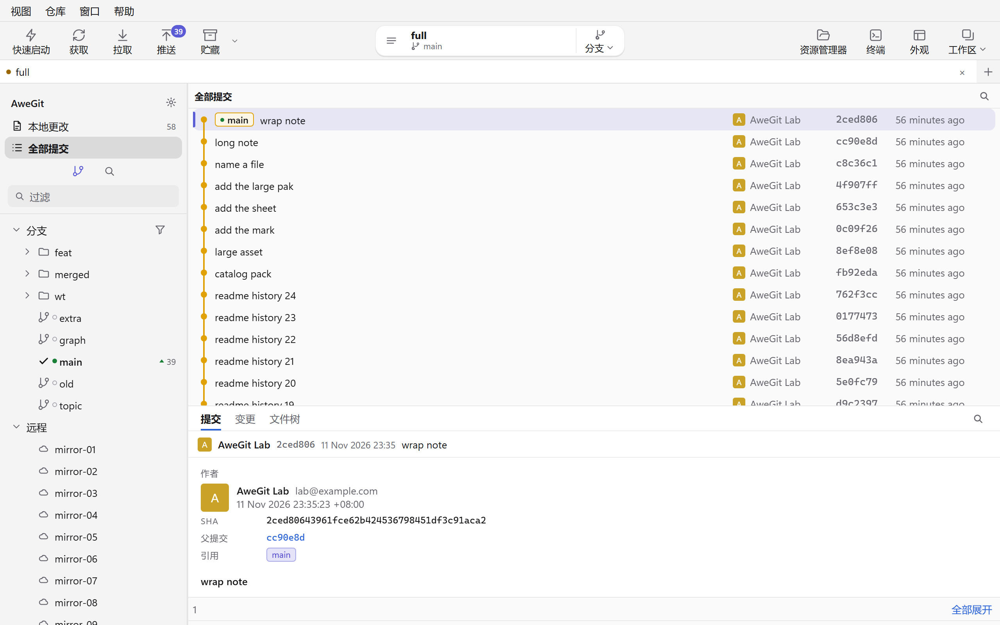
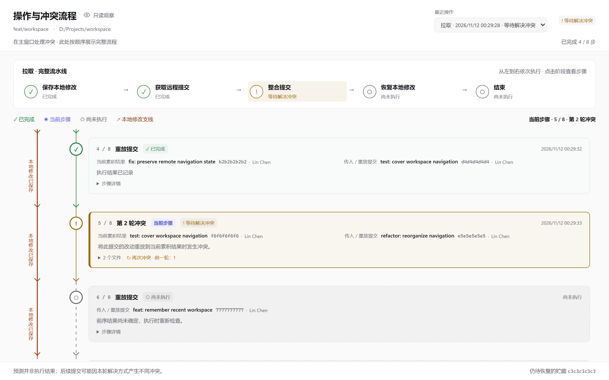

# AweGit

AweGit 是 Windows 和 macOS 上的 Git 客户端。界面用 Tauri 2 和 SvelteKit，后端是 Rust。状态用 gitoxide 读取，差异文本、历史和写操作走本机的 `git`。

**[中文](#中文) · [English](#english)**

| 历史视图 | 操作与冲突流程 |
| --- | --- |
|  |  |

---

## 中文

### 功能

- **工作区与标签页**：给源码目录起别名（工作 / 个人），克隆和打开都从那一层开始。每个工作区记住自己的仓库、打开的标签和当前标签；标签可以改名、上色、竖排，关闭后能重新打开，标题栏可以显示工作区名。
- **本地试验隔离**：仓库根目录的 `.fakeignore` 用 `.gitignore` 语法，把本地测试文件从变更列表里藏起来，不改 Git 自己的忽略规则。全部暂存和提交前会把匹配的已暂存文件移出，不会误提交；冲突文件始终显示。
- **变更与提交**：分栏差异、语法高亮、行内改动标记、空白显示或忽略、上下文行数、自动换行；按块暂存、丢弃或复制。提交主题强制写成 `type: 描述`，支持 AI 生成简单或详细说明、提交并推送、修订、署名、签名和跳过钩子。
- **历史与差异**：当前分支或所有分支的提交图，领先 / 落后、远程缺失和未推送都有标记；按说明或内容搜索提交；文件历史、追溯、引用日志、任意版本的文件内容；提交统计和 mailmap；图片差异支持并排、滑动、洋葱皮和像素差分。侧栏标签按时间倒序，目录分组按组内最新标签排列。
- **合并与冲突**：左右两侧是对方和自己的版本，只勾一侧就保留那一侧，两侧都勾按顺序合并；多个冲突文件可以批量保留同一侧。内置合并直接打开可拖动、缩放的独立窗口，重启后记住位置、大小和最大化状态；关闭或切换文件前保护未应用的选择和草稿，保存失败可继续修改并重试。也可交给外部合并工具；工作区不干净时先自动贮藏；有未选择的冲突时不能完成解决。
- **操作与冲突流程**：操作因待解决冲突停下时，自动打开只读的流程窗口，沿时间轴展示保存本地修改、获取、整合、恢复和结束各阶段的提交、文件、命令与时间。日志保存在仓库的 Git 目录里，支持中断恢复、重复冲突关联和后续步骤预测；自动打开和解决后自动关闭都能在偏好设置里关掉。
- **远程与托管**：获取、拉取、推送会记住修剪、标签、变基这些选项；推送默认带 `--force-with-lease`；可以提交后立即推送，建标签时一起推。首选项的账户页按远程主机选用已登录账号，覆盖常见托管和自建主机。添加或修改远程地址时，弹窗按地址显示将使用的已同步账号。可以用系统浏览器登录，也可以粘贴令牌并测试连通。阿里云代码托管走 codeup.aliyun.com，登录打开 account.aliyun.com。SSH 远程仍走密钥。通知和拉取请求在窗口内。HTTP / SOCKS 代理、证书和 SSL 校验在网络页。
- **仓库工具**：后台克隆、新建仓库、Git Flow、交互变基、拣选、还原、压缩、软 / 混合 / 硬重置、二分查找；贮藏可以只收选中文件或从贮藏建分支；子模块、工作树、LFS 锁定、批量删除已合并分支；自定义命令可以给所有仓库或只给当前仓库，需要时再提问；SSH 配置、终端和文件管理器都能从仓库菜单打开。
- **窗口与体验**：历史、文件内容和合并可以单独开窗口；快速启动搜索命令和文件；命令记录分开用户操作、后台、错误和通知；文件被占用时点名程序与 PID 并给出解除步骤；更新可以下载安装包并静默安装；Fork 设置可以导入。偏好设置共 11 个页签，语言支持中文、英文或跟随系统；主题提供 Apple Liquid Glass（默认）、经典白色、VS Code 黑色，也支持跟随系统，独立窗口同步切换。

### 下载与安装

安装包发布在 [GitHub Releases](https://github.com/ZhouJun2303/Gitnuro/releases)。版本清单是 `release` 分支根目录的 `latest.json`。

- **Windows**：NSIS 的 `AweGit_<版本>_x64-setup.exe` 和 MSI。安装包自带 MinGit 2.56.0，日常操作不需要另装 Git。当前版本是 2.0.9，安装包文件名是 `AweGit_2.0.9_x64-setup.exe` 和 `AweGit_2.0.9_x64_en-US.msi`。
- **macOS**：磁盘镜像在 `target/release/bundle` 或 Releases。使用系统 Git，不打包 MinGit；没有 Developer ID 签名时安装包未签名、未公证，需要在系统设置中允许打开。

设置保存在 Windows 的 `%APPDATA%\AweGit\settings.json`、macOS 的 `~/Library/Application Support/AweGit/settings.json`。API key、代理密码和各平台 token 放在系统凭据库，配置文件里这些字段是空的。

### 快速开始

需要 Node.js、pnpm 和 Rust 工具链。Windows 的 PATH、WinLibs 和工具链细节见 [开发与发布](dev-docs/development.md)。

```powershell
pnpm install
pnpm start
```

常用命令：

| 要做的事 | 命令 |
| --- | --- |
| 启动桌面程序（等同 `pnpm tauri dev`） | `pnpm start` |
| 浏览器试验台 | `pnpm dev` |
| 类型检查 | `pnpm check` |
| Rust 单元测试 | `pnpm test` |
| 本次改动相关的 UI 用例 | `pnpm test:ui -- <测试文件> --grep <用例名称>` |
| 打 Windows 安装包 | `pnpm package:windows` |
| 打 macOS 安装包 | `pnpm package:mac` |
| 发布到 GitHub | `publish.bat` |

UI 用例只跑本次修改涉及的场景，不跑全量。改到的页面要在 Apple、经典白色、VS Code 黑色下都测到相关面板，做法见 `dev-docs/development.md`。新弹窗要记入 `src/lib/lab/scenes.ts`，否则 `pnpm check` 会失败。

### 分支、提交与发布

- `feat/dev`：日常开发分支，功能和修复都提交到这里。
- `release`：发布分支，只放发布提交和 `latest.json`，受 GitHub 规则集保护，只有仓库所有者能直接推送。
- 协作者从 `feat/dev` 开分支，向 `feat/dev` 提 Pull Request。仓库默认分支是 `release`，base 要手动改成 `feat/dev`。
- 发布在 `feat/dev` 上运行 `publish.bat`：提交版本号、合并进 `release`、打包上传，再回到 `feat/dev`。

提交主题写成 `type: 描述`，类型有 `feat`、`fix`、`docs`、`art`、`style`、`refactor`、`test`、`chore`、`perf`、`revert`。输入框里写 `fix: 修复登录` 时类型会自动移到左侧选择器，中文冒号也认。

### 更多文档

- [功能介绍页](docs/index.html)（[在线版](https://zhoujun2303.github.io/Gitnuro/)）：带截图的功能介绍，支持中英文切换。
- [开发与发布](dev-docs/development.md)：环境准备、测试、试验台、打包、发布流程和完整快捷键表。
- 快捷键：在功能介绍页的[快捷键](https://zhoujun2303.github.io/Gitnuro/#shortcuts)一节，或开发文档的“窗口快捷键”。

### 许可证

AweGit 基于 Gitnuro 修改，以 GNU GPL v3 发布。详见 [NOTICE](NOTICE) 和 [LICENSE](LICENSE)。

---

## English

AweGit is a Git client for Windows and macOS. The interface is built with Tauri 2 and SvelteKit; the backend is Rust. Status is read with gitoxide, while diffs, history, and write operations go through the local `git`.

### Features

- **Workspaces and tabs**: give each source folder an alias such as Work or Personal, and clone or open from that root. A workspace remembers its repositories, open tabs, and selected tab. Tabs can be renamed, colored, laid out vertically, and reopened after closing; the title bar can show the workspace name.
- **Local experiment isolation**: a `.fakeignore` at the repository root uses `.gitignore` syntax to hide local files from the change lists without changing Git's own ignore rules. Stage-all and commit move matching staged files back out, so they are not committed by accident. Conflicts stay visible.
- **Changes and commits**: split diffs with syntax highlighting, inline change marks, whitespace display or ignore, context lines, and wrapping. Stage, discard, or copy a hunk. The subject must read `type: description`. AI can generate a short or long message, and the same box supports commit-and-push, amend, sign-off, signing, and skipping hooks.
- **History and diffs**: a graph for the current branch or every branch, with ahead/behind, missing remote, and unpushed markers. Search commits by message or content. Open file history, blame, reflog, and any revision of a file. Commit stats and mailmap. Image diffs support side by side, swipe, onion skin, and pixel difference. Sidebar tags run newest first, with directory groups sorted by their latest tag.
- **Merge and conflicts**: theirs and ours sit side by side. Pick one side, or both to combine them in order; a selection of conflict files can take the same side together. The built-in merge opens in a movable, resizable window that remembers its position, size, and maximized state across restarts. Closing or switching files protects unapplied choices and drafts; a failed save keeps them available for retry. External merge tools are also supported. A dirty work tree is stashed first. Resolve stays unavailable while a conflict is unpicked.
- **Operation pipeline**: when an operation stops on unresolved conflicts, a read-only pipeline window opens. A timeline shows save-local-edits, fetch, integrate, restore, and finish stages with their commits, files, commands, and timing. The log lives in the repository's Git directory and supports interrupted recovery, repeated-conflict links, and later-step prediction. Auto-open and close-after-resolve can be turned off in preferences.
- **Remotes and hosting**: fetch, pull, and push remember prune, tag, and rebase options. Push uses `--force-with-lease` by default. A commit can push immediately, and a new tag can go with it. The Accounts page in preferences picks the signed-in account for each remote host, including common forges and self-hosted servers. Adding or editing a remote address shows the synced account that URL will use. Sign in with the system browser, or paste a token and test the connection. Alibaba Cloud git uses codeup.aliyun.com, and sign-in opens account.aliyun.com. SSH remotes still use keys. Notifications and pull requests live in the window. HTTP/SOCKS proxies, certificates, and SSL verification stay on the Network page.
- **Repository tools**: background clone, new repository, Git Flow, interactive rebase, cherry-pick, revert, squash, soft/mixed/hard reset, and bisect. Stash selected files or grow a branch from a stash. Submodules, worktrees, LFS locking, and batch deletion of merged branches. Custom commands can be shared or limited to one repository and can ask for a value. SSH config, the terminal, and the file manager open from the repository menu.
- **Window and experience**: history, file contents, and merge can each open in their own window. Quick launch searches commands and files. The command log separates your actions, background work, errors, and notices. A file held by another program is reported with its process name and PID plus recovery steps. Updates can download and silently install a package. Fork settings can be imported. Preferences have 11 tabs and support Chinese, English, or the system language. Choose Apple Liquid Glass (default), Classic White, VS Code Dark, or follow the system; appearance changes also reach independent windows.

### Download and install

Packages are published on [GitHub Releases](https://github.com/ZhouJun2303/Gitnuro/releases). The version manifest is `latest.json` at the root of the `release` branch.

- **Windows**: the NSIS `AweGit_<version>_x64-setup.exe` and an MSI. The installer bundles MinGit 2.56.0, so no separate Git installation is needed.
- **macOS**: the disk image is under `target/release/bundle` or on Releases. macOS uses the system Git and does not bundle MinGit. Without a Developer ID the build is unsigned and not notarized, so macOS asks you to allow it in System Settings.

Settings live at `%APPDATA%\AweGit\settings.json` on Windows and `~/Library/Application Support/AweGit/settings.json` on macOS. API keys, proxy passwords, and per-platform tokens go to the OS credential store, leaving those fields empty in the file.

### Quick start

Node.js, pnpm, and a Rust toolchain are required. Windows PATH, WinLibs, and toolchain details are in [Development and release](dev-docs/development.md) (Chinese).

```powershell
pnpm install
pnpm start
```

Common commands:

| What you want | Command |
| --- | --- |
| Start the desktop app (same as `pnpm tauri dev`) | `pnpm start` |
| Browser lab | `pnpm dev` |
| Type check | `pnpm check` |
| Rust unit tests | `pnpm test` |
| UI tests related to this change | `pnpm test:ui -- <spec file> --grep <test name>` |
| Build the Windows installers | `pnpm package:windows` |
| Build the macOS package | `pnpm package:mac` |
| Publish to GitHub | `publish.bat` |

UI tests run only the scenes touched by the change, never the full set. A changed page is tested in Apple Liquid Glass, classic light, and VS Code dark, down to the panels that changed. The commands are in `dev-docs/development.md`. A new dialog must be added to `src/lib/lab/scenes.ts`, or `pnpm check` fails.

### Branches, commits, and releases

- `feat/dev` is the daily branch for features and fixes.
- `release` holds release commits and `latest.json`. It is protected, and only the repository owner can push to it directly.
- Contributors branch from `feat/dev` and open pull requests against `feat/dev`. The repository default branch is `release`, so the base must be changed by hand.
- Run `publish.bat` on `feat/dev` to commit the version, merge into `release`, build, upload, and return to `feat/dev`.

Subjects read `type: description`, with types `feat`, `fix`, `docs`, `art`, `style`, `refactor`, `test`, `chore`, `perf`, and `revert`. Typing `fix: repair login` moves `fix` into the selector on the left; a full-width colon works too.

### More documentation

- [Feature guide](docs/index.html) ([online](https://zhoujun2303.github.io/Gitnuro/)): screenshots and feature notes, with a Chinese/English switch.
- [Development and release](dev-docs/development.md): environment, tests, lab, packaging, publishing, and the full shortcut table (Chinese).
- Shortcuts: the [shortcuts section](https://zhoujun2303.github.io/Gitnuro/#shortcuts) of the feature guide, or "窗口快捷键" in the development doc.

### License

AweGit is based on Gitnuro and released under the GNU GPL v3. See [NOTICE](NOTICE) and [LICENSE](LICENSE).

---

[回到顶部](#awegit) · [Back to top](#awegit)
